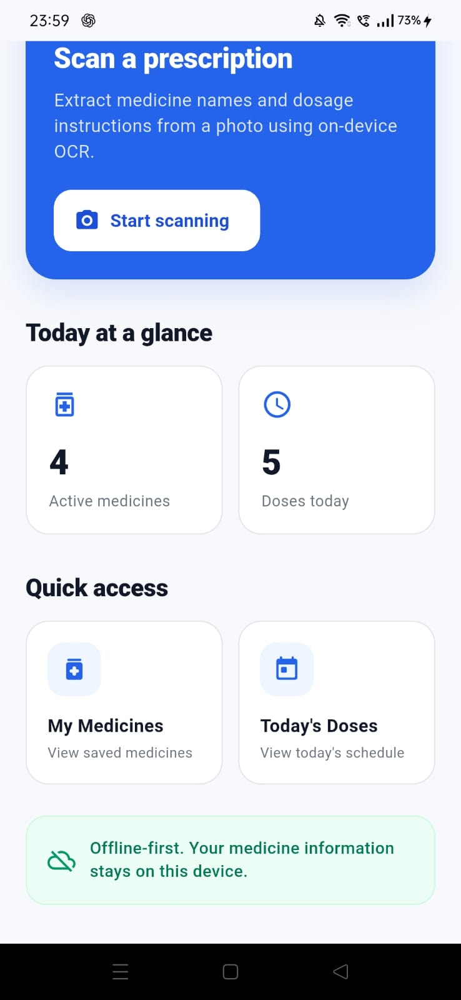

# MediScan Lite

> **Smart Prescription & Medicine Care --- Offline-First Flutter
> Application**

MediScan Lite is a Flutter-based mobile application developed as a
college project to demonstrate how **on-device OCR, prescription
information extraction, medicine scheduling, local storage, and
medication reminders** can be combined into a simple offline-first
healthcare utility.

The application allows a user to scan or select a prescription image,
extract its text on the device, review detected medicine details, create
a medicine schedule, save medicines locally, view today's doses, and
receive local reminder notifications.

------------------------------------------------------------------------

## ✨ Key Features

### 📷 Prescription Scanning

-   Capture a prescription using the device camera or choose an existing
    image.
-   Extract prescription text using **on-device OCR**.
-   No server upload is required for OCR processing.

### 💊 Medicine Extraction & Review

The application presents detected medicine information such as: -
Medicine name - Dosage - Frequency - Duration - Timing / instructions

Users can review the extracted information before saving the schedule.

### 🗓️ Medicine Scheduling

-   Converts saved medicine information into a daily dose schedule.
-   Supports different frequency patterns such as once, twice, and three
    times daily.
-   Displays today's planned doses in a dedicated **Today's Doses**
    screen.

### 🔔 Local Medicine Reminders

-   Creates local Android notifications for scheduled doses.
-   Reminder data is stored locally on the device.
-   Supports notification permission handling.
-   Notifications are rescheduled when saved medicines are changed.
-   Includes a test notification option for verifying the reminder
    system.

### 📱 My Medicines

-   View all saved medicines.
-   Remove individual medicines.
-   Clear saved medicines.
-   Updating or removing medicines automatically updates the reminder
    schedule.

### 🔒 Offline-First Design

-   Medicine information is stored locally.
-   OCR runs on-device.
-   No login, backend, or cloud database is required.
-   Designed to keep prescription-related information on the user's
    device.

------------------------------------------------------------------------

## 🧩 Application Flow

``` text
Prescription Image
        ↓
   Scan / Select
        ↓
   On-Device OCR
        ↓
 Extracted Prescription Text
        ↓
 Medicine Schedule Review
        ↓
     Save Medicines
        ↓
 Local Storage + Reminder Scheduling
        ↓
 ┌─────────────────────────────┐
 │ My Medicines                │
 │ Today's Doses               │
 │ Local Notifications         │
 └─────────────────────────────┘
```

------------------------------------------------------------------------

## 🖥️ Main Screens

### Dashboard

The dashboard provides: - Prescription scanning entry point - Active
medicine count - Today's dose count - Quick access to My Medicines and
Today's Doses - Medicine reminder controls - Offline-first status

### Scan Prescription

The user can select or capture a prescription image. MediScan Lite
extracts the visible text using on-device OCR.

### Medicine Schedule

Detected medicines are displayed with their: - Name - Dosage -
Instruction - Frequency - Duration - Timing

The user can review the extracted information before saving.

### Today's Doses

Shows the planned doses for the current day, including scheduled times
and medicine instructions.

### My Medicines

Shows saved medicines and provides options to remove individual
medicines or clear the complete local medicine list.

------------------------------------------------------------------------

## 🛠️ Technologies Used

  -----------------------------------------------------------------------
  Technology                          Purpose
  ----------------------------------- -----------------------------------
  **Flutter**                         Cross-platform mobile application
                                      development

  **Dart**                            Application programming language

  **Google ML Kit Text Recognition**  On-device OCR

  **flutter_local_notifications**     Local medicine reminder
                                      notifications

  **SharedPreferences**               Local medicine data storage

  **Timezone**                        Scheduling notifications using
                                      local time

  **Image Picker**                    Camera/gallery prescription image
                                      selection

  **Android SDK**                     Android application platform
  -----------------------------------------------------------------------

------------------------------------------------------------------------

## 📦 Important Flutter Packages

The project uses packages including:

``` yaml
image_picker
google_mlkit_text_recognition
shared_preferences
flutter_local_notifications
timezone
```

------------------------------------------------------------------------

## 🏗️ Project Structure

``` text
med_scan_lite/
│
├── android/
│   └── app/
│       ├── src/
│       │   └── main/
│       │       └── AndroidManifest.xml
│       └── build.gradle.kts
│
├── lib/
│   ├── main.dart
│   ├── scan_screen.dart
│   ├── medicine_schedule_screen.dart
│   ├── my_medicines_screen.dart
│   └── notification_service.dart
│
├── test/
│   └── widget_test.dart
│
├── pubspec.yaml
├── pubspec.lock
└── README.md
```

------------------------------------------------------------------------

## ⚙️ Requirements

Before running the project, install:

-   Flutter SDK
-   Dart SDK (included with Flutter)
-   Android Studio / Android SDK
-   Android device or Android Emulator
-   USB debugging enabled if using a physical Android phone

The project was developed and tested with:

-   **Flutter 3.47.7**
-   **Dart 3.13.5**
-   **Android SDK 36**
-   **Java 17**
-   Android device testing

------------------------------------------------------------------------

## 🚀 Getting Started

### 1. Clone the repository

``` bash
git clone <YOUR_GITHUB_REPOSITORY_URL>
cd med_scan_lite
```

### 2. Install dependencies

``` bash
flutter pub get
```

### 3. Check the project

``` bash
flutter analyze
```

### 4. Connect an Android device

Enable:

``` text
Developer Options
        ↓
USB Debugging
```

Then verify the device:

``` bash
flutter devices
```

### 5. Run the application

``` bash
flutter run
```

------------------------------------------------------------------------

## 🔔 Notification Setup

MediScan Lite uses local Android notifications rather than a cloud
notification service.

When reminders are enabled:

1.  The app requests Android notification permission.
2.  Saved medicine schedules are converted into notification times.
3.  Notifications are scheduled locally on the device.
4.  Updating or deleting medicines rebuilds the reminder schedule.
5.  Clearing all medicines cancels the scheduled reminders.

The project uses **inexact notification scheduling** so that the
application does not require exact-alarm permission.

------------------------------------------------------------------------

## 🔐 Privacy & Data Handling

MediScan Lite is designed as an **offline-first college project**.

-   Prescription OCR is performed on-device.
-   Saved medicine information is stored locally.
-   The project does not require a backend server.
-   No user account is required.
-   No cloud database is required for the core application.
-   Medicine reminders are generated locally on the Android device.

> **Privacy note:** Do not commit real patients' prescription images,
> names, phone numbers, medical records, or other personally
> identifiable information to a public GitHub repository. Use
> synthetic/demo data for screenshots and testing.

------------------------------------------------------------------------

## ⚠️ Medical Safety Disclaimer

MediScan Lite is an **educational college project and software
demonstration**. It is not a medical diagnosis, treatment, or
prescription-verification system.

OCR can make mistakes. Extracted medicine names, dosage values,
frequency, duration, and instructions must always be checked against the
original prescription and the instructions provided by a qualified
healthcare professional.

**Do not rely on the application to determine or change medical
treatment.**

------------------------------------------------------------------------

## 🧪 Demonstrated Project Workflow

The completed application demonstrates the following end-to-end
workflow:

``` text
1. Open MediScan Lite
        ↓
2. Scan / select prescription
        ↓
3. Run on-device OCR
        ↓
4. Review extracted prescription information
        ↓
5. Create medicine schedule
        ↓
6. Review medicines, dosage, frequency,
   duration and timing
        ↓
7. Save medicines
        ↓
8. View My Medicines
        ↓
9. View Today's Doses
        ↓
10. Enable local reminders
        ↓
11. Receive Android medicine notifications
```

------------------------------------------------------------------------

## 📸 Screenshots

The repository can include screenshots demonstrating:

-   Dashboard
-   Scan Prescription
-   Extracted Text
-   Medicine Schedule
-   Today's Doses
-   Medicine Reminder dialog
-   Android notification
-   My Medicines

Recommended repository structure:

``` text
docs/
└── screenshots/
    ├── dashboard.png
    ├── scan-prescription.png
    ├── extracted-text.png
    ├── medicine-schedule.png
    ├── todays-doses.png
    ├── reminder-dialog.png
    └── notification.png
```

Then add images to this section using GitHub-relative paths, for
example:

``` markdown

```

> Before publishing screenshots, replace any real-looking patient
> information with clearly synthetic/demo information.

------------------------------------------------------------------------

## 🎓 Academic Project

**Project:** MediScan Lite\
**Category:** Mobile Application Development / Healthcare Utility\
**Platform:** Android\
**Development Framework:** Flutter\
**Architecture:** Offline-first, local-device application

This project demonstrates practical implementation of:

-   Mobile UI development
-   Image acquisition
-   Optical Character Recognition
-   Text processing
-   Structured medicine information extraction
-   Local data persistence
-   Schedule generation
-   Android local notifications
-   Permission handling
-   Offline-first application design

------------------------------------------------------------------------

## 🔮 Future Enhancements

Possible future improvements include:

-   More accurate medicine-field extraction
-   Editable medicine schedules
-   Custom reminder times
-   Dose completion tracking
-   Medication history
-   Better OCR post-processing
-   Prescription image cropping and enhancement
-   Multiple prescription profiles
-   Accessibility improvements
-   More robust support for handwritten prescriptions
-   Optional encrypted local storage

------------------------------------------------------------------------

## 👨‍💻 Developer

Developed as an academic project using Flutter and Dart.

**Developer:** Bhavy Chauhan\
**Course:** Integrated M.Sc. (CA & IT)\
**University:** Gujarat University\
**Project:** MediScan Lite

------------------------------------------------------------------------

## 📄 License

This project is intended primarily for academic and educational
purposes.

If you choose to publish the repository publicly, review the licenses of
all third-party Flutter packages and assets used by the project before
adding a separate open-source license.

------------------------------------------------------------------------

## ⭐ Project Summary

**MediScan Lite** demonstrates how a mobile application can turn a
prescription image into a locally stored medicine schedule with
on-device OCR and Android medication reminders --- while keeping the
core workflow offline-first and focused on privacy.
